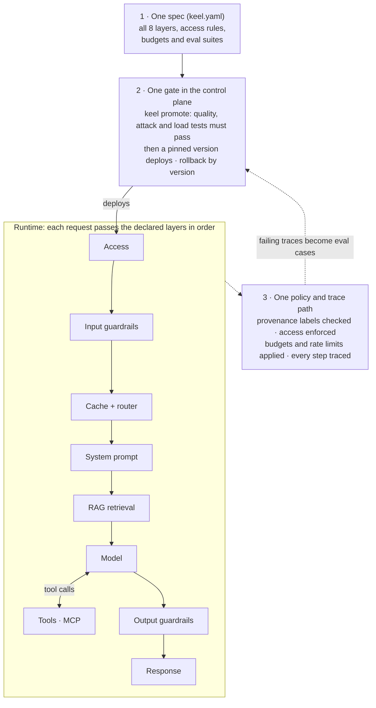

# Keel architecture

**Status: in design.** Names and details may change.

## Overview

The spec feeds a control plane. The control plane compiles the spec, runs the gate on quality, attack and load tests, and deploys a pinned version to the runtime.
In the runtime each request passes through the declared layers in order.
Every layer runs through the same policy and trace path. Failing traces flow back into the gate as new eval cases.

## Five properties, three mechanisms

| Property | Delivered by | Checked by |
|---|---|---|
| Secure | Provenance policy, one policy engine at retrieval and tool-call time, guardrails, tamper-evident audit log | Attack suites in the gate |
| Scalable | Stateless async runtime, semantic cache, cost- and latency-based routing, per-tenant budgets and rate limits | Load tests |
| Reliable | Eval gate, pinned spec versions, rollback, fallbacks, retries, timeouts, replay from traces | Quality suites and fault-injection tests |
| Simple | One spec, six CLI commands, secure defaults, `keel audit` scorecard | Quickstart under 10 minutes |
| Clean architecture | Core depends only on interfaces; each layer is a port with adapters | Architecture tests in CI |

The mechanisms reinforce each other:

- The spec is both the simplicity boundary and the security boundary. What is not declared cannot run.
- The gate proves security, reliability and scale together. Attack, quality and load tests block the same promotion.
- Clean interfaces make security and scaling uniform. Whatever backend a layer uses, it passes through the same policy and tracing hooks.

## Provenance policy

Every piece of data the agent reads carries a label for its source and sensitivity.
One policy decides which labels may reach which action or output.
The idea comes from CaMeL (Google DeepMind, 2025) and FIDES (Microsoft, 2025). Keel implements a simple label-and-gate version.

## Layer scope

| # | Layer | Scope |
|---|---|---|
| 01 | Model | Provider-agnostic calls, streaming, structured output, fallbacks, retries, timeouts, cost accounting |
| 02 | System prompt | Versioned templates, variables, few-shot sets, prompt registry |
| 03 | RAG | Ingestion, chunking, embeddings, hybrid search, reranking, citations |
| 04 | Tools · MCP | MCP client and server, tool registry, sandboxed execution, agent loop with step limits |
| 05 | Access | OIDC, API keys, RBAC and attribute policies, multi-tenancy |
| 06 | Guardrails | PII, prompt injection, toxicity, topic filters, human approval, provenance policy |
| 07 | Cache + router | Exact and semantic cache, cost and latency routing, rate limits, budgets |
| 08 | Observability | OpenTelemetry traces, logs, metrics, eval runner, regression reports |

Security controls are designed against the OWASP Top 10 for LLM Applications 2026 and the Top 10 for Agentic Applications 2026.

## Build or integrate

Build the spec compiler, CLI, control plane, eval gate, policy engine, audit log and a thin provenance policy.
Integrate mature components behind Keel interfaces: LiteLLM for model calls, pgvector or Qdrant for vectors, the MCP Python SDK, Presidio for PII, Ragas or DeepEval for metrics, OPA or Casbin as rule evaluator, and OpenTelemetry for tracing.

Rule of thumb: if a component is not part of the spec, the gate or the policy and trace path, integrate it.

## Build order

1. Spec and core
2. Observability
3. Model and system prompt
4. Eval runner and gate
5. RAG
6. Tools · MCP
7. Access
8. Guardrails
9. Cache and router
10. Console, docs and hardening

Observability and the gate come early because every later layer is checked by them.

## Open questions

- Final project name
- Serve all three audiences at v1.0, or lead with one?
- Web console in Next.js, or Python-only with HTMX?
- Self-hosted only, or also a one-command local mode?
